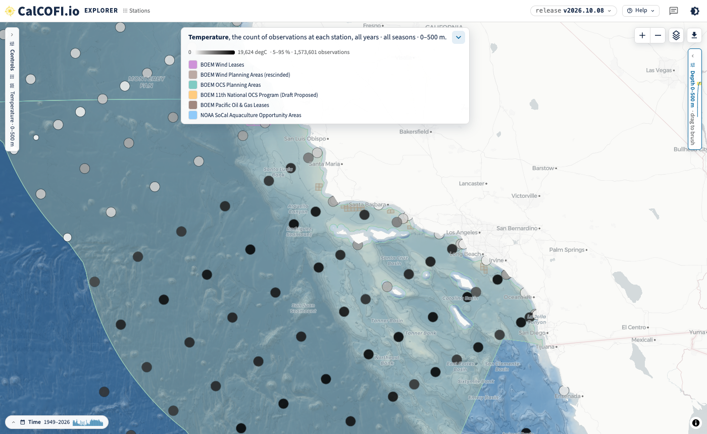
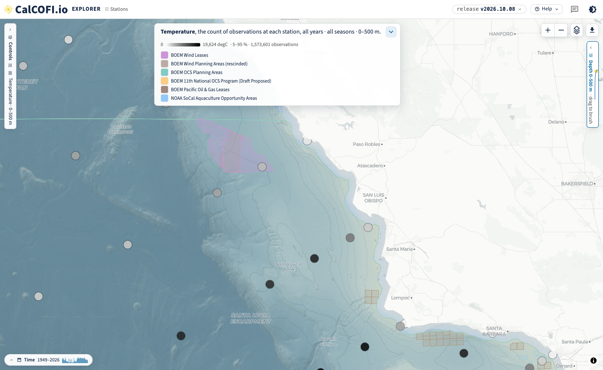
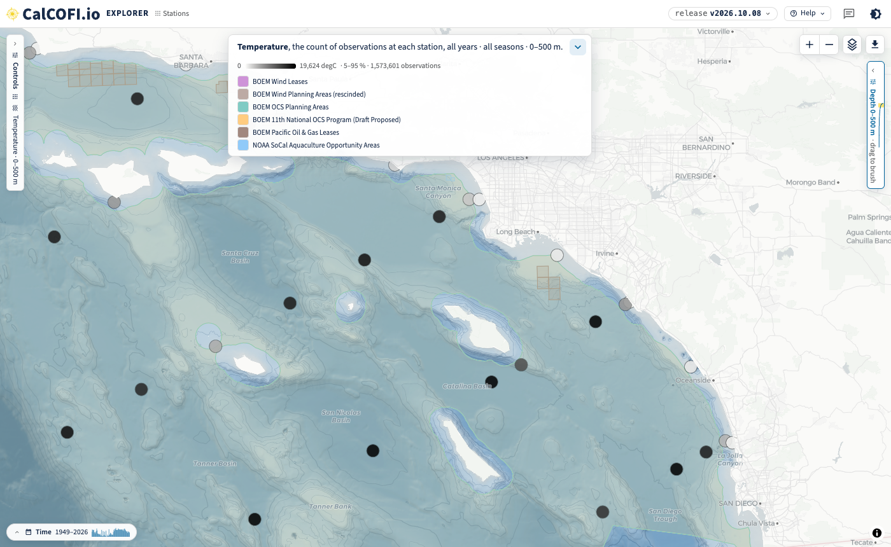
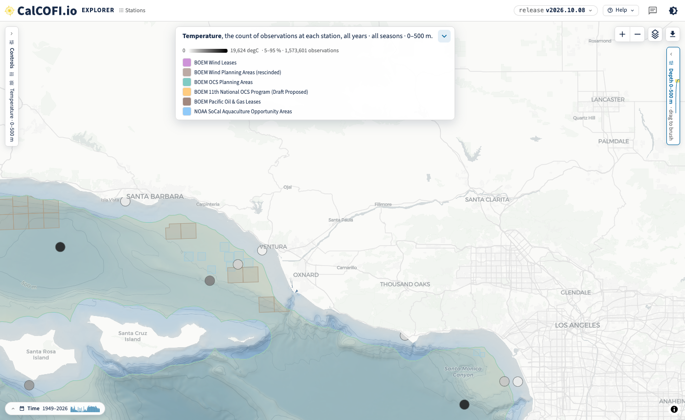
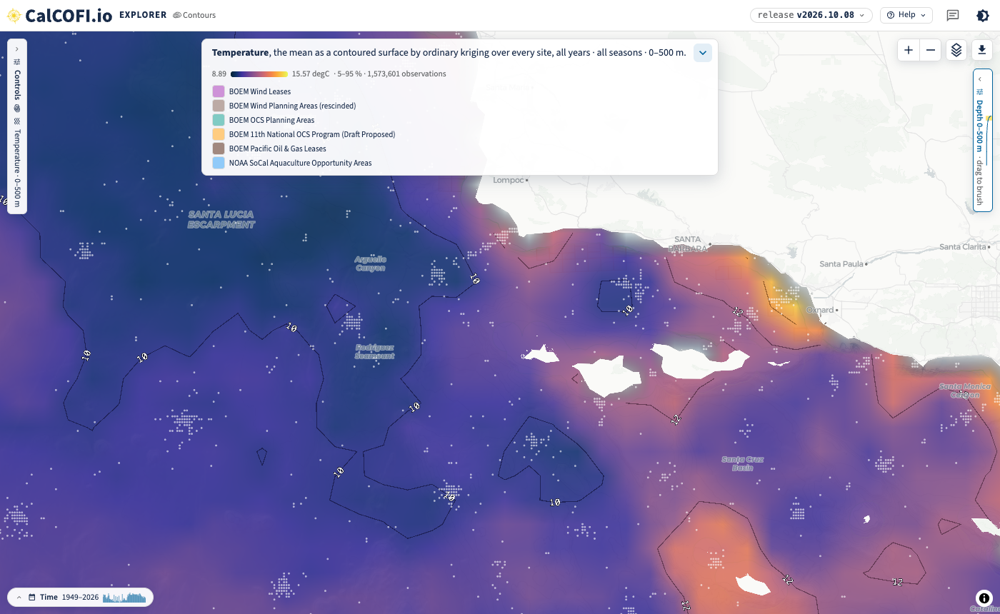
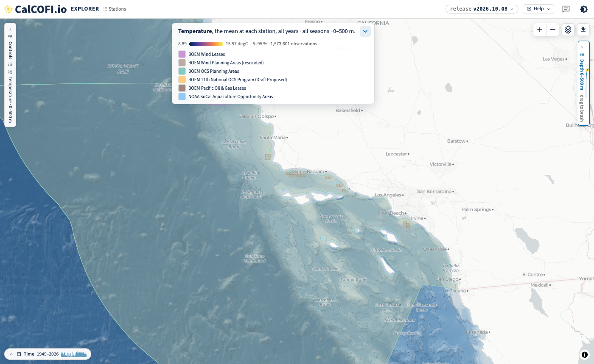
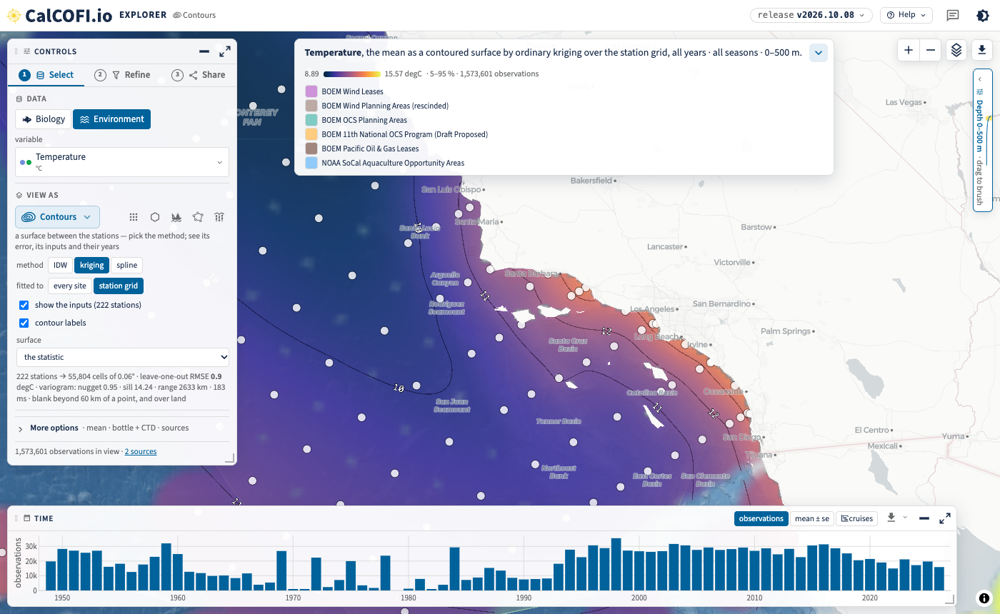
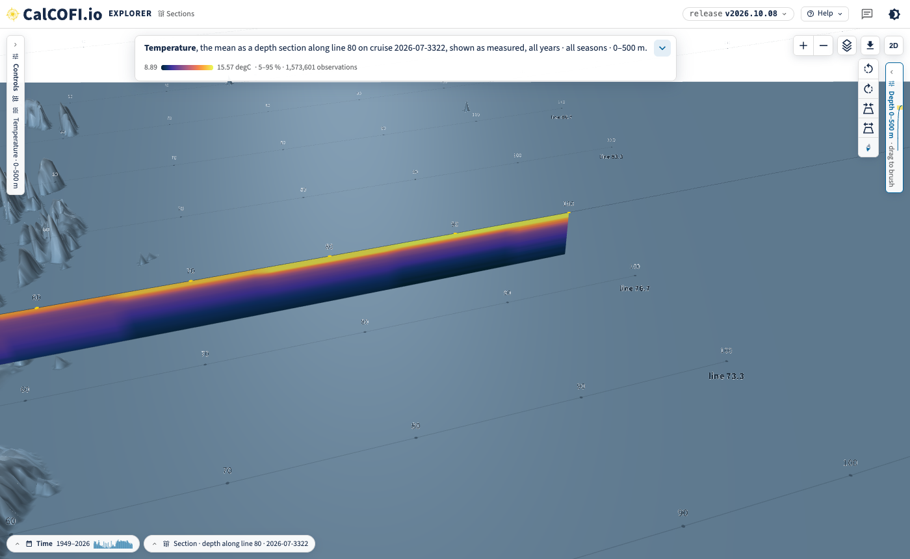

## What changed {#sec-changed}

Erin, 2026-10-02 (email "Stations (and lines?) overlaid on WEAs"): *"I need a map of the CalCOFI
stations (and lines, if possible) with the Wind Energy Areas behind them (and maybe even gas and
oil areas and AOAs)."*

The [CalCOFI Explorer](https://calcofi.io/explore/) now draws its energy and industry boundaries
from the [Ocean Metrics places gazetteer](https://oceanmetrics.io/places), so the other apps can
use the same layers. Six layers are wired in, under **Layers → Add a layer → Energy & Industry**:

| Explorer layer | What it is | Gazetteer collection |
|---|---|---|
| BOEM Wind Leases | lease outlines; the popup gives each lease's current status and status date | [`boem_wind_leases`](https://storage.oceanmetrics.io/gazetteer/boem_wind_leases/README.md) |
| BOEM Wind Planning Areas (rescinded) | the planning areas and WEAs BOEM rescinded on 30 July 2025, kept as history | [`boem_wind_planning_rescinded`](https://storage.oceanmetrics.io/gazetteer/boem_wind_planning_rescinded/README.md) |
| BOEM OCS Planning Areas | Outer Continental Shelf oil and gas planning areas | [`boem_ocs_planning`](https://storage.oceanmetrics.io/gazetteer/boem_ocs_planning/README.md) |
| BOEM 11th National OCS Program (Draft Proposed) | the draft program areas, including those off California | [`boem_program_11_draft`](https://storage.oceanmetrics.io/gazetteer/boem_program_11_draft/README.md) |
| BOEM Pacific Oil & Gas Leases | active Pacific OCS oil and gas leases | [`boem_pacific_og_leases`](https://storage.oceanmetrics.io/gazetteer/boem_pacific_og_leases/README.md) |
| NOAA SoCal Aquaculture Opportunity Areas | NOAA Fisheries' Southern California AOAs | [`noaa_aoa_socal`](https://storage.oceanmetrics.io/gazetteer/noaa_aoa_socal/README.md) |

: The energy and industry layers in the Explorer, each a collection of the gazetteer with its own
licence, attribution and provenance in its README. {#tbl-layers}

Every map below is a link: it opens the same view, and everything on it (lens, layers, colours,
extent) can be changed from there. The screenshots are from release v2026.10.08.

## Stations with the wind areas behind them {#sec-stations-wea}

The **Stations** lens draws one dot per CalCOFI station. In these links the boundary layers sit
*under* the data in the Layers card (the order of the *On the map* rows), so the stations draw on
top of the wind, oil and gas and aquaculture polygons.

[Open in the Explorer: stations over all six layers, Point Conception to San
Diego](https://calcofi.io/explore/?tour=off&var=temperature&hide=select,years&lens=station&stat=n&ramp=gray_r&map=-120.2,34.1,6.45&layers=gebco_gazetteer,data,boem_wind_planning,boem_wind_planning_rescinded,boem_ocs_planning,boem_program_11_draft,boem_pacific_og_leases,noaa_aoa_socal)

{#fig-region}

Off the Central Coast, the Morro Bay leases (purple) sit over the rescinded Morro Bay WEA
(brown), with the oil and gas leases off Point Arguello and in the Santa Barbara Channel to the
south. Hover a lease for its status.

[Open in the Explorer: the Central
Coast](https://calcofi.io/explore/?tour=off&var=temperature&hide=select,years&lens=station&stat=n&ramp=gray_r&map=-121.3,35.3,7.7&layers=gebco_gazetteer,data,boem_wind_planning,boem_wind_planning_rescinded,boem_ocs_planning,boem_program_11_draft,boem_pacific_og_leases,noaa_aoa_socal)

{#fig-central}

The Humboldt leases lie north of the CalCOFI grid, so there are no stations near them to show.

## Oil and gas areas and AOAs {#sec-og-aoa}

Erin, 2026-10-05: *"Also do we have oil/gas & AOAs too?"* Yes: the oil and gas leases (brown
outlines), the OCS planning areas and the draft 11th Program areas, and NOAA's aquaculture
opportunity areas (the small blue squares off Ventura and Oxnard).

[Open in the Explorer: Southern California
Bight](https://calcofi.io/explore/?tour=off&var=temperature&hide=select,years&lens=station&stat=n&ramp=gray_r&map=-118.6,33.55,7.9&layers=gebco_gazetteer,data,boem_wind_planning,boem_wind_planning_rescinded,boem_ocs_planning,boem_program_11_draft,boem_pacific_og_leases,noaa_aoa_socal)

{#fig-socal}

[Open in the Explorer: the aquaculture opportunity areas off
Ventura](https://calcofi.io/explore/?tour=off&var=temperature&hide=select,years&lens=station&stat=n&ramp=gray_r&map=-119.05,34.35,8.7&layers=gebco_gazetteer,data,boem_wind_planning,boem_wind_planning_rescinded,boem_ocs_planning,boem_program_11_draft,boem_pacific_og_leases,noaa_aoa_socal)

{#fig-aoa}

## A dot at the centre of each cluster, over the sea floor only {#sec-centres}

Erin, 2026-10-05: *"is there a way to put a black dot at the 'center' of these clusters and just
have a basemap that is the ocean floor (not temp)?"*

The clusters are the **Contours** lens fitted to *every site*: each cast at its own position, so
the repeat occupations of one station scatter around it (@fig-clusters).

[Open in the Explorer: Contours over every
site](https://calcofi.io/explore/?tour=off&var=temperature&hide=select,years&lens=contour&interp=krig&grain=site&inputs=on&map=-120.55,34.15,7.9&layers=gebco_gazetteer,data,boem_wind_planning,boem_wind_planning_rescinded,boem_ocs_planning,boem_program_11_draft,boem_pacific_og_leases,noaa_aoa_socal)

{#fig-clusters}

The centre of each cluster is the station itself, and the **Stations** lens is exactly that: one
dot per station over the sea floor, with no temperature surface. The links in
@sec-stations-wea and @sec-og-aoa colour each dot by its **count of observations** on a grey ramp,
so the well-sampled stations are black and the rarely visited ones pale (@fig-region). To get the
sea floor and the boundaries with no dots at all, turn the **Data** row off in the Layers card:

[Open in the Explorer: the sea floor and the six layers
only](https://calcofi.io/explore/?tour=off&var=temperature&hide=select,years&lens=station&data=off&map=-120.2,34.1,6.45&layers=gebco_gazetteer,data,boem_wind_planning,boem_wind_planning_rescinded,boem_ocs_planning,boem_program_11_draft,boem_pacific_og_leases,noaa_aoa_socal)

{#fig-seafloor}

Not there yet: a single plain black dot for every station, whatever its count. That option is
still to be added to the Explorer.

## How many stations go into a surface {#sec-inputs}

Erin, 2026-10-02: *"To be able to see how many stations are actually going into the
interpolation/mean for a given summarized area."*

In the Contours lens, fitted to the **station grid**, **show the inputs** draws every station the
surface was fitted to, sized by how many observations it holds, and the checkbox gives their
number (222 stations here). Under it the fit reports itself: the number of points, the
leave-one-out error and the variogram. The Stations lens with *count of observations* (@fig-region)
gives the same at each station, and **Regions** gives a mean and its count inside each polygon of a
boundary layer (sanctuaries, protected areas, counties; not yet the gazetteer layers above).

[Open in the Explorer: Contours over the station grid, inputs
shown](https://calcofi.io/explore/?tour=off&var=temperature&map=-120.4,33.9,6.3&lens=contour&interp=krig&grain=station&inputs=on&layers=gebco_gazetteer,data,boem_wind_planning,boem_wind_planning_rescinded,boem_ocs_planning,boem_program_11_draft,boem_pacific_og_leases,noaa_aoa_socal)

{#fig-inputs}

## The lines {#sec-lines}

On the 2-D map the lines read as the diagonal rows of station dots (@fig-region), but they are not
labelled there yet. The **Sections** lens in **3-D** draws the whole station pattern at the sea
surface, each line threaded and named at both ends, and every station numbered.

[Open in the Explorer: line 80 in
3-D](https://calcofi.io/explore/?tour=off&var=temperature&hide=select,years&lens=section&line=80&view=3d)

{#fig-lines}

## Diablo Canyon and the age of the wind data {#sec-diablo}

Erin, 2026-10-05: *"I think that the Diablo canyon area is no longer a thing right? Just verifying
that the WEA dataset is a recent one."* Answered by email on 2026-10-08:

- Diablo Canyon was only a 2018 call area. It was never designated a WEA or leased, and it is in
  none of BOEM's current layers.
- BOEM rescinded all designated WEAs, including Humboldt and Morro Bay, on 30 July 2025. They are
  the *rescinded* history layer (@tbl-layers).
- The five California leases from the December 2022 auction are still drawn, each with its status
  from BOEM's California page in the popup (cancelled, relinquished, under settlement or
  unchanged).
- The [Data Basin layer](https://caoffshorewind.databasin.org/maps/new/#datasets=ec0cd811194540258fa203af171531f4)
  is a 2022 snapshot of the proposed, pre-auction lease areas, so it is not used.

The gazetteer re-checks its sources weekly and records when each layer was retrieved
(@tbl-layers).

## Still to do {#sec-todo}

- A plain black dot for every station, whatever its count (@sec-centres).
- The lines labelled on the 2-D map (@sec-lines).
