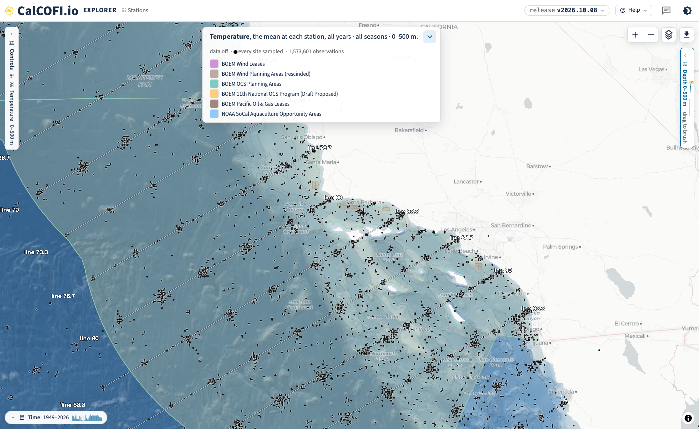
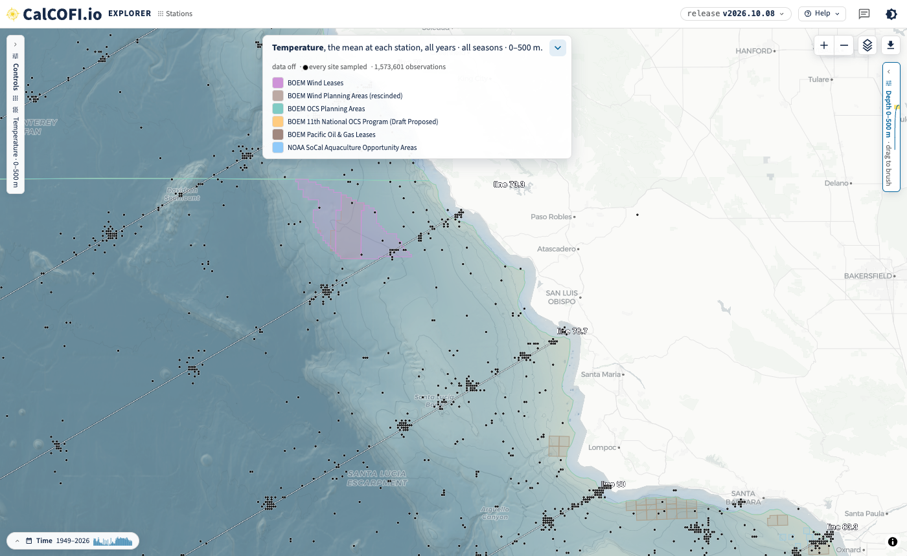
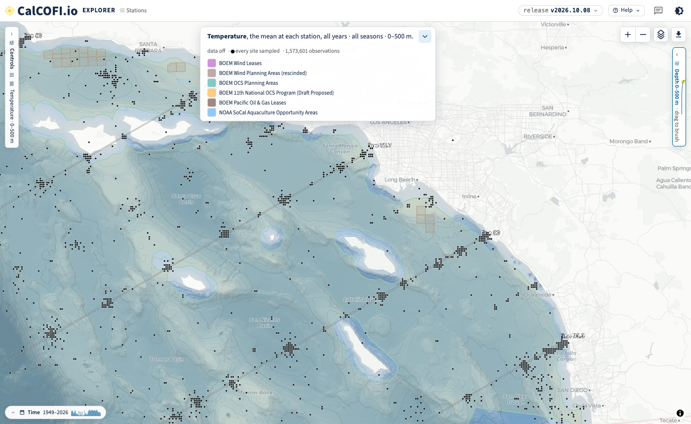
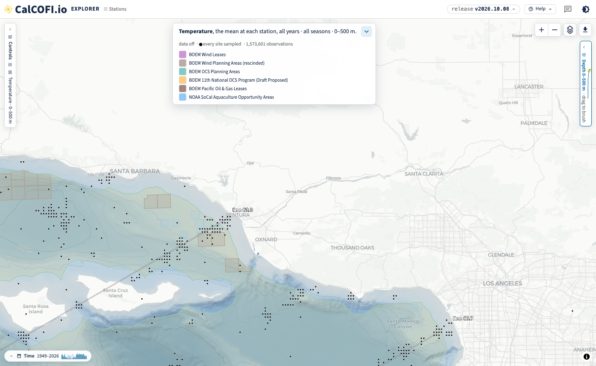
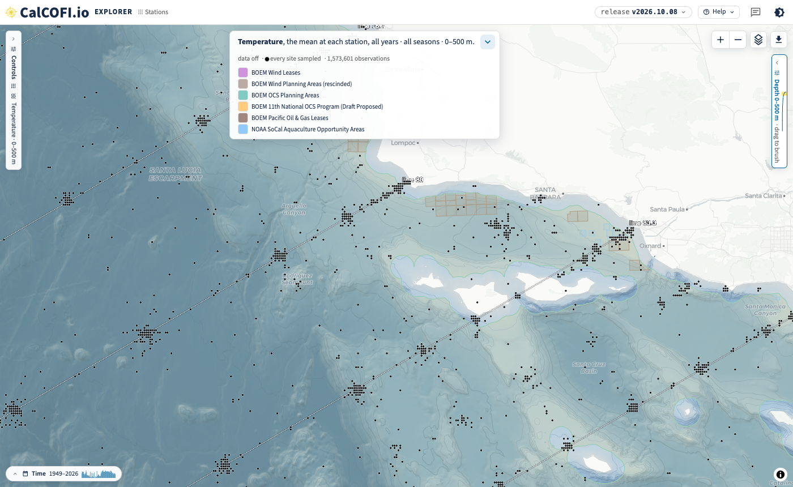
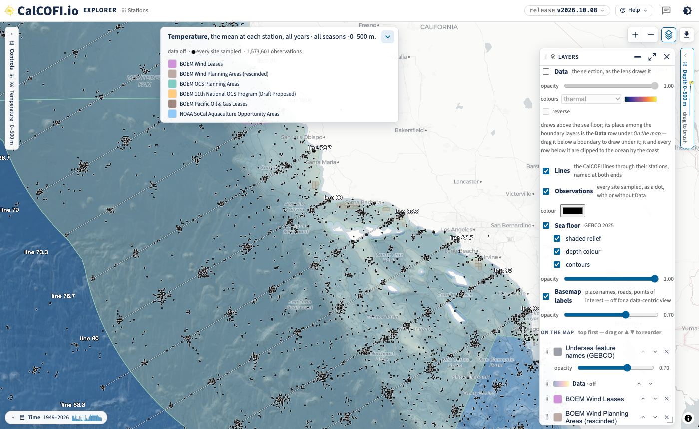
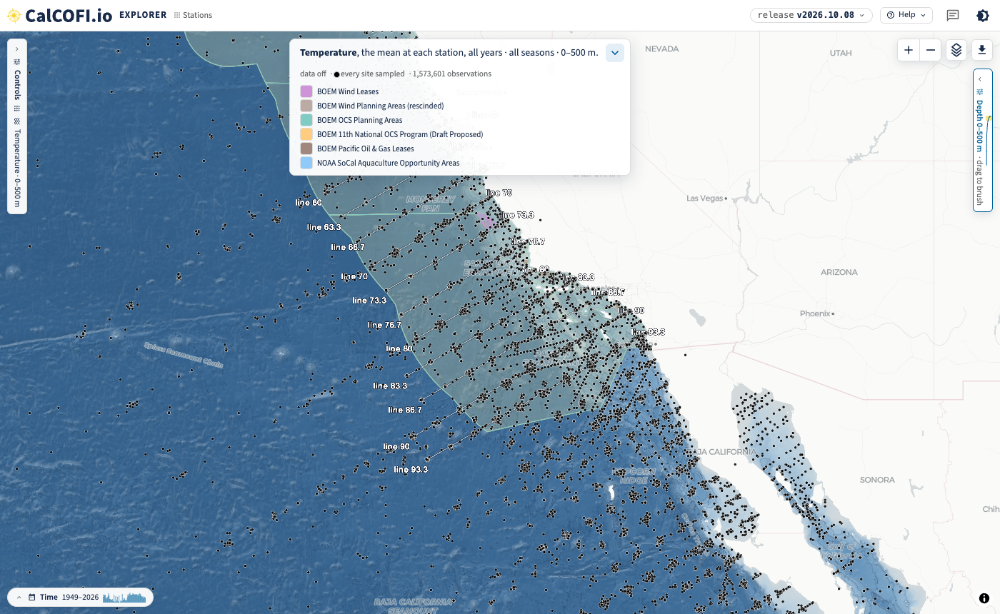

## What changed {#sec-changed}

Erin, 2026-10-02 (email "Stations (and lines?) overlaid on WEAs"): *"I need a map of the CalCOFI
stations (and lines, if possible) with the Wind Energy Areas behind them (and maybe even gas and
oil areas and AOAs)."*

The [CalCOFI Explorer](https://calcofi.io/explore/) now draws its energy and industry boundaries
from the [Ocean Metrics places gazetteer](https://oceanmetrics.io/places), so the other apps can
use the same layers. Six layers are wired in, under **Layers → Add a layer → Energy & Industry**:

| Explorer layer | What it is | Gazetteer collection |
|---|---|---|
| BOEM Wind Leases | lease outlines; the popup gives each lease's current status and status date | [`boem_wind_leases`](https://storage.oceanmetrics.io/gazetteer/boem_wind_leases/README.md) |
| BOEM Wind Planning Areas (rescinded) | the planning areas and WEAs BOEM rescinded on 30 July 2025, kept as history | [`boem_wind_planning_rescinded`](https://storage.oceanmetrics.io/gazetteer/boem_wind_planning_rescinded/README.md) |
| BOEM OCS Planning Areas | Outer Continental Shelf oil and gas planning areas | [`boem_ocs_planning`](https://storage.oceanmetrics.io/gazetteer/boem_ocs_planning/README.md) |
| BOEM 11th National OCS Program (Draft Proposed) | the draft program areas, including those off California | [`boem_program_11_draft`](https://storage.oceanmetrics.io/gazetteer/boem_program_11_draft/README.md) |
| BOEM Pacific Oil & Gas Leases | active Pacific OCS oil and gas leases | [`boem_pacific_og_leases`](https://storage.oceanmetrics.io/gazetteer/boem_pacific_og_leases/README.md) |
| NOAA SoCal Aquaculture Opportunity Areas | NOAA Fisheries' Southern California AOAs | [`noaa_aoa_socal`](https://storage.oceanmetrics.io/gazetteer/noaa_aoa_socal/README.md) |

: The energy and industry layers in the Explorer, each a collection of the gazetteer with its own
licence, attribution and provenance in its README. {#tbl-layers}

The Explorer also has two new layers (@sec-how): **Observations**, every cast at its own position as
a black dot, and **Lines**, each CalCOFI line threaded through its stations and named at both ends.
Both draw with or without the data, so the maps below show the sampling and the lines over the sea
floor and the boundaries with no temperature colour.

Every map below is a link: it opens the same view, and everything on it (lens, layers, colours,
extent) can be changed from there. The screenshots are from release v2026.10.08.

## Every cast over the wind areas, sea floor only {#sec-obs-wea}

Each black dot is a site where temperature was sampled (a CTD or bottle cast, at its own position to
0.01°, all years, 0–500 m), over the GEBCO sea floor and the six layers, with the data layer off. The
repeat occupations of a station make the clusters, and the white lines thread the stations of each
CalCOFI line, named at both ends.

[Open in the Explorer: Point Conception to San Diego](https://calcofi.io/explore/?tour=off&var=temperature&hide=select,years&lens=station&data=off&obs=on&lines=on&map=-120.2,34.1,6.45&layers=gebco_gazetteer,data,boem_wind_planning,boem_wind_planning_rescinded,boem_ocs_planning,boem_program_11_draft,boem_pacific_og_leases,noaa_aoa_socal)

{#fig-obs-region}

Off the Central Coast, the Morro Bay leases (purple) sit over the rescinded Morro Bay WEA (brown),
with the oil and gas leases off Point Arguello to the south. Hover a lease for its status.

[Open in the Explorer: the Central Coast](https://calcofi.io/explore/?tour=off&var=temperature&hide=select,years&lens=station&data=off&obs=on&lines=on&map=-121.3,35.3,7.7&layers=gebco_gazetteer,data,boem_wind_planning,boem_wind_planning_rescinded,boem_ocs_planning,boem_program_11_draft,boem_pacific_og_leases,noaa_aoa_socal)

{#fig-obs-central}

The Humboldt leases lie north of the CalCOFI grid, so there are no casts near them to show.

## Oil and gas areas and AOAs {#sec-og-aoa}

Erin, 2026-10-05: *"Also do we have oil/gas & AOAs too?"* Yes: the oil and gas leases (brown
outlines), the OCS planning areas and the draft 11th Program areas, and NOAA's aquaculture
opportunity areas (the small blue squares off Ventura and Oxnard).

[Open in the Explorer: Southern California Bight](https://calcofi.io/explore/?tour=off&var=temperature&hide=select,years&lens=station&data=off&obs=on&lines=on&map=-118.6,33.55,7.9&layers=gebco_gazetteer,data,boem_wind_planning,boem_wind_planning_rescinded,boem_ocs_planning,boem_program_11_draft,boem_pacific_og_leases,noaa_aoa_socal)

{#fig-obs-socal}

[Open in the Explorer: the aquaculture opportunity areas off Ventura](https://calcofi.io/explore/?tour=off&var=temperature&hide=select,years&lens=station&data=off&obs=on&lines=on&map=-119.05,34.35,8.7&layers=gebco_gazetteer,data,boem_wind_planning,boem_wind_planning_rescinded,boem_ocs_planning,boem_program_11_draft,boem_pacific_og_leases,noaa_aoa_socal)

{#fig-obs-aoa}

## The clusters, up close {#sec-centres}

Erin, 2026-10-05: *"is there a way to put a black dot at the 'center' of these clusters and just
have a basemap that is the ocean floor (not temp)?"* Closer in, each cluster resolves into the
individual casts at one station: the ship's position on each occupation.

[Open in the Explorer: the Santa Barbara Channel](https://calcofi.io/explore/?tour=off&var=temperature&hide=select,years&lens=station&data=off&obs=on&lines=on&map=-120.55,34.15,7.9&layers=gebco_gazetteer,data,boem_wind_planning,boem_wind_planning_rescinded,boem_ocs_planning,boem_program_11_draft,boem_pacific_og_leases,noaa_aoa_socal)

{#fig-obs-zoom}

## How to draw it yourself {#sec-how}

Open **Layers** (top right of the map): untick **Data**, tick **Lines** and **Observations** (and
pick the dots' colour), then add or remove boundary layers under **Add a layer → Energy & Industry**. The dots follow the
selection, so choosing another variable, an organism, years, seasons or depths changes which casts
or tows are drawn. The link (Share, or the address bar) carries all of it: `data=off&obs=on&lines=on`.

{#fig-obs-card}

If a single dot per station is wanted instead, the **Stations** lens with the data on draws one,
here shaded by its count of observations ([open in the Explorer](https://calcofi.io/explore/?tour=off&var=temperature&hide=select,years&lens=station&stat=n&ramp=gray_r&map=-120.2,34.1,6.45&layers=gebco_gazetteer,data,boem_wind_planning,boem_wind_planning_rescinded,boem_ocs_planning,boem_program_11_draft,boem_pacific_og_leases,noaa_aoa_socal)).

{#fig-stations}

## How many stations go into a surface {#sec-inputs}

Erin, 2026-10-02: *"To be able to see how many stations are actually going into the
interpolation/mean for a given summarized area."*

In the Contours lens, fitted to the **station grid**, **show the inputs** draws every station the
surface was fitted to, sized by how many observations it holds, and the checkbox gives their
number (222 stations here). Under it the fit reports itself: the number of points, the
leave-one-out error and the variogram. The Stations lens with *count of observations* (@fig-stations)
gives the same at each station, and **Regions** gives a mean and its count inside each polygon of a
boundary layer (sanctuaries, protected areas, counties; not yet the gazetteer layers above).

[Open in the Explorer: Contours over the station grid, inputs
shown](https://calcofi.io/explore/?tour=off&var=temperature&map=-120.4,33.9,6.3&lens=contour&interp=krig&grain=station&inputs=on&layers=gebco_gazetteer,data,boem_wind_planning,boem_wind_planning_rescinded,boem_ocs_planning,boem_program_11_draft,boem_pacific_og_leases,noaa_aoa_socal)

{#fig-inputs}

## The lines {#sec-lines}

Erin, 2026-10-02: *"a map of the CalCOFI stations (and lines, if possible)"*. The **Lines** layer
threads each line through its official stations and writes its name past both ends, on the 2-D
map in every lens. Historical positions the program no longer works are not threaded, nor is an
inshore station on a line of its own.

[Open in the Explorer: every line, with every cast](https://calcofi.io/explore/?tour=off&var=temperature&hide=select,years&lens=station&data=off&obs=on&lines=on&layers=gebco_gazetteer,data,boem_wind_planning,boem_wind_planning_rescinded,boem_ocs_planning,boem_program_11_draft,boem_pacific_og_leases,noaa_aoa_socal)

{#fig-lines-2d}

The **Sections** lens in **3-D** draws the same pattern at the sea surface, each station numbered,
under a section hanging over the sea floor.

[Open in the Explorer: line 80 in 3-D](https://calcofi.io/explore/?tour=off&var=temperature&hide=select,years&lens=section&line=80&view=3d)

{#fig-lines}

## Diablo Canyon and the age of the wind data {#sec-diablo}

Erin, 2026-10-05: *"I think that the Diablo canyon area is no longer a thing right? Just verifying
that the WEA dataset is a recent one."* Answered by email on 2026-10-08:

- Diablo Canyon was only a 2018 call area. It was never designated a WEA or leased, and it is in
  none of BOEM's current layers.
- BOEM rescinded all designated WEAs, including Humboldt and Morro Bay, on 30 July 2025. They are
  the *rescinded* history layer (@tbl-layers).
- The five California leases from the December 2022 auction are still drawn, each with its status
  from BOEM's California page in the popup (cancelled, relinquished, under settlement or
  unchanged).
- The [Data Basin layer](https://caoffshorewind.databasin.org/maps/new/#datasets=ec0cd811194540258fa203af171531f4)
  is a 2022 snapshot of the proposed, pre-auction lease areas, so it is not used.

The gazetteer re-checks its sources weekly and records when each layer was retrieved
(@tbl-layers).
